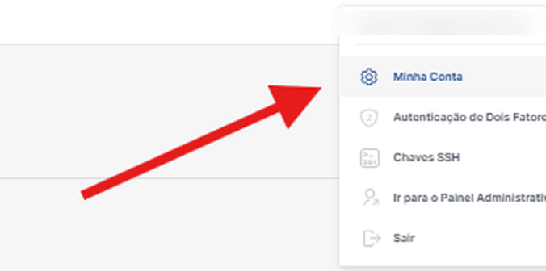
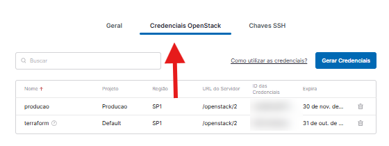
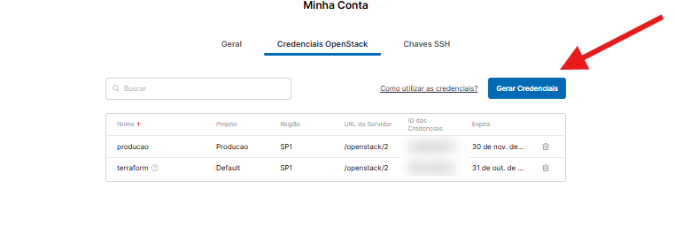
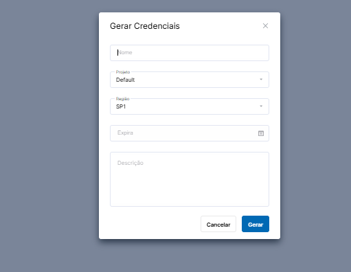
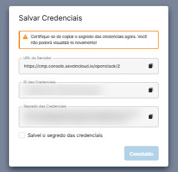

# Procedimento: Cluster Kubernetes na SaveInCloud com Terraform

Este procedimento cria, a partir de um projeto vazio no painel da SaveInCloud, uma rede privada, um
cluster Kubernetes gerenciado e as ferramentas **Traefik**, **Argo CD**, **Prometheus** e **Grafana**,
usando Terraform a partir do seu notebook. O único passo manual é criar a credencial de acesso no
painel.

## Sumário

- [Visão geral](#visão-geral)
- [Pré-requisitos](#pré-requisitos)
- [Passo 1: Criar a credencial de acesso no painel](#passo-1-criar-a-credencial-de-acesso-no-painel)
- [Passo 2: Configurar o clouds.yaml e testar o acesso](#passo-2-configurar-o-cloudsyaml-e-testar-o-acesso)
- [Passo 3: Conferir imagem, rede externa e cota](#passo-3-conferir-imagem-rede-externa-e-cota)
- [Passo 4: Obter o projeto e preencher o terraform.tfvars](#passo-4-obter-o-projeto-e-preencher-o-terraformtfvars)
- [Passo 5: Criar o cluster](#passo-5-criar-o-cluster)
- [Passo 6: Acessar o cluster](#passo-6-acessar-o-cluster)
- [Passo 7: Instalar a plataforma](#passo-7-instalar-a-plataforma)
- [Passo 8: Acessar o monitoramento](#passo-8-acessar-o-monitoramento)
- [Operação do dia a dia](#operação-do-dia-a-dia)
  - [Remover ou reinstalar um componente](#remover-ou-reinstalar-um-componente)
  - [Apagar o ambiente inteiro](#apagar-o-ambiente-inteiro)
- [Solução de problemas](#solução-de-problemas)
- [Segurança da credencial](#segurança-da-credencial)

## Visão geral

O Terraform cria tudo em duas etapas, cada uma com o seu `terraform apply`: primeiro a
**infraestrutura** (rede e cluster, Passo 5), depois a **plataforma** (StorageClass, Traefik, Argo CD,
Prometheus e Grafana, Passos 7 e 8).

| Etapa | Recurso | Nome criado |
| --- | --- | --- |
| Rede | Rede privada | `<cluster>-net` |
| Rede | Subnet com DNS | `<cluster>-subnet` |
| Rede | Roteador com saída para a internet | `<cluster>-router` |
| Kubernetes | Template do cluster (versão, Cilium, discos) | `<cluster>-template` |
| Kubernetes | Chave SSH dos nós | `<cluster>-key` |
| Kubernetes | Cluster (mestres, workers e load balancer da API) | `<cluster>` |
| Kubernetes | Grupo de workers com autoscaling | `autoscale` |
| Acesso | Arquivo kubeconfig no notebook | `kubeconfig/<cluster>.yaml` |
| Plataforma | StorageClass para volumes persistentes (Cinder) | `csi-cinder-ssd` |
| Plataforma | Traefik (entrada HTTP/HTTPS com IP público) | namespace `traefik` |
| Plataforma | Argo CD | namespace `argocd` |
| Plataforma | Prometheus e Grafana (métricas, alertas e dashboards) | namespace `monitoring` |

O projeto Terraform separa três coisas:

| O quê | Onde fica | Vai para o Git? |
| --- | --- | --- |
| Credencial de acesso | `~/.config/openstack/clouds.yaml` | Nunca |
| Configuração | `environments/<ambiente>/terraform.tfvars` | Sim |
| Estado (o que já foi criado) | `terraform.tfstate` | Não, pois contém o kubeconfig |

Estrutura do projeto:

```
terraform-openstack/
├── modules/              # COMO cada componente é criado
│   ├── network/          # rede, subnet, roteador
│   ├── k8s-cluster/      # template, chave SSH, cluster, autoscaling
│   ├── storage-class/    # StorageClass padrão do Cinder
│   ├── traefik/          # cada componente da plataforma tem o seu values.yaml
│   ├── argocd/
│   ├── prometheus/
│   └── grafana/
└── environments/
    ├── dev/              # infraestrutura do ambiente dev
    │   └── platform/     # plataforma do ambiente dev
    └── prod/             # infraestrutura do ambiente prod
        └── platform/     # plataforma do ambiente prod
```

## Pré-requisitos

Você precisa de acesso ao painel da SaveInCloud (`cmp.console.saveincloud.io`) e de um projeto com
cota livre. No notebook, use um terminal Linux:

| Sistema | Terminal a usar |
| --- | --- |
| Windows | Ubuntu no WSL (`wsl --install -d Ubuntu` no PowerShell como administrador) |
| Linux | Terminal do próprio sistema |
| macOS | Terminal, com as ferramentas instaladas pelo Homebrew |

Instale as ferramentas. No Ubuntu (inclusive no WSL):

```bash
sudo apt-get update
sudo apt-get install -y gnupg curl lsb-release unzip git python3-openstackclient python3-magnumclient

# Terraform (repositório oficial da HashiCorp)
curl -fsSL https://apt.releases.hashicorp.com/gpg | sudo gpg --dearmor -o /usr/share/keyrings/hashicorp-archive-keyring.gpg
echo "deb [signed-by=/usr/share/keyrings/hashicorp-archive-keyring.gpg] https://apt.releases.hashicorp.com $(lsb_release -cs) main" | sudo tee /etc/apt/sources.list.d/hashicorp.list
sudo apt-get update && sudo apt-get install -y terraform

# kubectl
sudo snap install kubectl --classic
```

No macOS:

```bash
brew install terraform kubectl git
pip3 install python-openstackclient python-magnumclient
```

Confira as versões e crie sua chave SSH, caso ainda não tenha:

```bash
terraform version        # 1.5 ou superior
openstack --version
kubectl version --client
ls ~/.ssh/id_ed25519.pub || ssh-keygen -t ed25519 -f ~/.ssh/id_ed25519 -N ""
```

> **Importante:** a partir daqui, nenhum comando usa `sudo`. Rodar o Terraform como root faz ele
> procurar a chave e a credencial em `/root`, e a execução falha.

## Passo 1: Criar a credencial de acesso no painel

A credencial (ID + secret) é o que permite ao Terraform agir no seu projeto. Ela vale para **um
projeto** apenas: se você tiver mais de um projeto, crie uma credencial para cada.

1. Acesse `https://cmp.console.saveincloud.io` e faça login.
2. Clique no **ícone do seu usuário**, no canto superior direito, e escolha **Minha Conta**.

   

3. Abra a aba **Credenciais OpenStack**. A lista mostra as credenciais que você já tem, com projeto,
   região e data de expiração.

   

4. Clique em **Gerar Credenciais**.

   

5. Preencha o formulário:

   

   | Campo | O que informar |
   | --- | --- |
   | Nome | Um nome que identifique o uso, por exemplo `terraform-producao` |
   | Projeto | O projeto onde o cluster será criado |
   | Região | `SP1` |
   | Expira | Data de validade da credencial (recomendado: no máximo 12 meses) |
   | Descrição | Opcional, por exemplo "Terraform do cluster Kubernetes" |

6. Clique em **Gerar**.
7. A tela **Salvar Credenciais** mostra os dados de acesso. **Copie o ID e o Segredo agora** (ícone de
   copiar ao lado de cada campo) e guarde-os em local seguro, como um cofre de senhas. O segredo
   aparece **uma única vez**.

   

   Cada campo da tela vai para um lugar do `clouds.yaml` (Passo 2):

   | Campo na tela | Onde usar no `clouds.yaml` |
   | --- | --- |
   | URL do Servidor | `auth_url` |
   | ID das Credenciais | `application_credential_id` |
   | Segredo das Credenciais | `application_credential_secret` |

   Depois de copiar, marque **Salvei o segredo das credenciais** e clique em **Concluído**. Se você
   perder o segredo, apague a credencial (ícone de lixeira na lista) e gere outra.

Ao expirar, a credencial deixa de autenticar: gere uma nova e atualize o `clouds.yaml`.

## Passo 2: Configurar o clouds.yaml e testar o acesso

O `clouds.yaml` guarda a credencial fora do projeto Terraform. O CLI do OpenStack e o Terraform leem
o mesmo arquivo.

1. Crie a pasta e o arquivo:

   ```bash
   mkdir -p ~/.config/openstack
   nano ~/.config/openstack/clouds.yaml
   ```

2. Cole o conteúdo abaixo, trocando o ID e o secret pelos do Passo 1:

   ```yaml
   clouds:
     saveincloud:
       auth_type: v3applicationcredential
       auth:
         auth_url: https://cmp.console.saveincloud.io/openstack/2
         application_credential_id: "COLE-AQUI-O-ID"
         application_credential_secret: "COLE-AQUI-O-SECRET"
       region_name: RegionOne
       interface: public
       identity_api_version: 3
   ```

3. Salve (`Ctrl+O`, Enter, `Ctrl+X` no nano) e proteja o arquivo:

   ```bash
   chmod 600 ~/.config/openstack/clouds.yaml
   ```

4. Teste a autenticação:

   ```bash
   export OS_CLOUD=saveincloud
   openstack token issue -c expires
   ```

   O comando deve devolver uma data em `expires`.

Três detalhes que causam erro com frequência:

- **Região:** o painel mostra `SP1`, mas a API usa `RegionOne`. Com `SP1` no arquivo, os comandos
  falham com `public endpoint ... in SP1 region not found`.
- **Indentação:** o YAML usa espaços, nunca tabulação.
- **Nome da entrada:** `saveincloud` é o nome usado no `OS_CLOUD` e no `os_cloud` do
  `terraform.tfvars`. Se mudar aqui, mude nos dois.

Com mais de um projeto, adicione uma entrada para cada um (por exemplo `saveincloud-prod`), cada uma
com a sua credencial.

## Passo 3: Conferir imagem, rede externa e cota

Antes de criar, confirme que o projeto tem o que o cluster precisa:

```bash
export OS_CLOUD=saveincloud
openstack image list | grep -i coreos
openstack network list --external -c ID -c Name
openstack limits show --absolute | grep -iE 'ram|cores|floating'
```

| Verificação | O que esperar | Onde usar |
| --- | --- | --- |
| Imagem | `fedora-coreos-x64-k8saas-secondary` | ID vai no campo `image` do tfvars |
| Rede externa | Duas redes: `public` e `cross_service` | Use `public` no campo `external_network_name` |
| Cota de RAM | `max_total_ram_size` menos `total_ram_used` | Precisa caber o cluster inteiro |
| Cota de vCPU | `max_total_cores` menos `total_cores_used` | Idem |

Conta da cota: `(mestres × RAM do flavor dos mestres) + (workers no máximo × RAM do flavor dos workers)`.
Exemplo da configuração de produção: 3 mestres `PRI-2-8` mais até 4 workers `PRI-4-8` dão 56 GB de
RAM e 22 vCPU.

Se a cota não comportar, reduza o tamanho no tfvars ou peça aumento de cota ao suporte da
SaveInCloud.

## Passo 4: Obter o projeto e preencher o terraform.tfvars

Clone o repositório na sua pasta pessoal. No Windows, mantenha o projeto **dentro do Linux** (`~/`) e
não em `/mnt/c`: o Terraform roda mais rápido e as permissões dos arquivos funcionam.

```bash
cd ~
git clone <endereço-do-repositório> terraform-openstack
cd ~/terraform-openstack/environments/prod
```

O projeto tem dois ambientes, cada um com sua configuração e seu estado: `environments/dev` e
`environments/prod`. Use a pasta do ambiente que você quer criar. O **único arquivo que você edita** é
o `terraform.tfvars` dessa pasta:

```hcl
os_cloud     = "saveincloud" # nome da entrada no clouds.yaml (Passo 2)
cluster_name = "k8s-prod"    # nome do cluster e prefixo dos recursos

external_network_name = "public"       # rede externa (Passo 3)
network_cidr          = "10.10.0.0/24" # faixa de IPs da rede do cluster

image        = "1a8b2fc8-47ae-4ab7-92b4-2869b63ceefb" # ID da imagem (Passo 3)
kube_version = "v1.35.3"

high_availability = true      # true = 3 mestres, false = 1 mestre
master_flavor     = "PRI-2-8" # mínimo 2 vCPU
worker_flavor     = "PRI-4-8"
worker_count      = 1         # workers fixos (base do cluster)

boot_volume_size      = 30 # disco de sistema de cada nó (GB)
container_volume_size = 50 # disco de contêineres de cada nó (GB)

autoscaling_enabled = true # liga/desliga o autoscaling
autoscaling_min     = 1    # mínimo de nós do grupo autoscale
autoscaling_max     = 3    # máximo de nós do grupo autoscale
```

Defina antes do primeiro apply: `cluster_name`, `high_availability`, os flavors, os discos e
`worker_count`. Mudar qualquer um deles depois **recria o cluster**. O autoscaling pode ser ajustado a
qualquer momento (veja [Operação do dia a dia](#operação-do-dia-a-dia)).

## Passo 5: Criar o cluster

Dentro da pasta do ambiente:

```bash
cd ~/terraform-openstack/environments/prod
export OS_CLOUD=saveincloud
terraform init
rm -f k8s.plan                   # descarta planos antigos
terraform plan -out=k8s.plan     # se este comando der erro, NÃO rode o apply
```

O `init` baixa o provider OpenStack (só na primeira vez). O `plan` mostra o que será criado e grava o
plano no arquivo `k8s.plan`. Num projeto vazio, o resumo deve ser:

```
Plan: 9 to add, 0 to change, 0 to destroy.
```

São 4 recursos de rede, o template, a chave SSH, o cluster, o grupo `autoscale` e o kubeconfig. Se o
resumo mostrar `destroy` num projeto vazio, pare e revise o tfvars.

Com o plano revisado, aplique:

```bash
terraform apply k8s.plan
```

O `apply k8s.plan` executa **exatamente** o plano revisado. Se algo mudou depois do plan, o Terraform
recusa (`Saved plan is stale`) e você gera um plano novo. A criação leva de 15 a 25 minutos. Para
acompanhar em outro terminal:

```bash
export OS_CLOUD=saveincloud
watch -n 30 'openstack coe cluster list -c name -c status'
```

O status passa de `CREATE_IN_PROGRESS` para `CREATE_COMPLETE`.

## Passo 6: Acessar o cluster

Ao terminar, o Terraform grava o kubeconfig na pasta do ambiente, com permissão restrita ao seu
usuário:

```bash
export KUBECONFIG=$(terraform output -raw kubeconfig_path)
kubectl get nodes -o wide
```

Todos os nós devem aparecer como `Ready`. Outras informações úteis:

```bash
terraform output                     # endereço da API, versão e ID do cluster
kubectl get pods -A                  # componentes do sistema rodando
openstack coe nodegroup list k8s-prod -c name -c node_count -c status
```

O `export KUBECONFIG` vale só para o terminal atual. Para não repetir, adicione ao `~/.bashrc`:

```bash
echo 'export KUBECONFIG=~/terraform-openstack/environments/prod/kubeconfig/k8s-prod.yaml' >> ~/.bashrc
```

## Passo 7: Instalar a plataforma

Com o cluster pronto, a segunda camada do Terraform instala a plataforma:

| Componente | Para quê |
| --- | --- |
| StorageClass `csi-cinder-ssd` | Volumes persistentes no Cinder (o cluster não vem com nenhuma) |
| Traefik | Porta de entrada HTTP/HTTPS do cluster, com IP público |
| Argo CD | Implantação de aplicações |
| Prometheus | Métricas e alertas (kube-prometheus-stack) |
| Grafana | Dashboards, já ligados ao Prometheus |

Ela fica na subpasta `platform` do ambiente e tem o seu próprio estado. Cada componente pode ser
desligado no tfvars.

1. Entre na pasta e confira o `terraform.tfvars`:

   ```bash
   cd ~/terraform-openstack/environments/prod/platform
   cat terraform.tfvars
   ```

   ```hcl
   kubeconfig_path = "../kubeconfig/k8s-prod.yaml" # gerado no Passo 5

   # StorageClass
   storage_class_enabled = true

   # Traefik
   traefik_enabled       = true
   traefik_chart_version = "42.4.1"

   # Argo CD
   argocd_enabled       = true
   argocd_chart_version = "10.18.0"
   # argocd_host = "argocd.suaempresa.com.br"     # opcional, veja abaixo

   # Monitoramento
   prometheus_enabled       = true
   prometheus_chart_version = "93.4.0"
   grafana_enabled          = true
   grafana_chart_version    = "14.5.0"
   # grafana_host = "grafana.suaempresa.com.br"   # opcional

   # Disco persistente para métricas e Grafana (veja o Passo 8)
   monitoring_storage_enabled = false
   ```

   O `kubeconfig_path` precisa apontar para o arquivo criado no Passo 5. Se você mudou o
   `cluster_name`, ajuste o nome do arquivo.

2. Crie os recursos, com o mesmo ciclo dos passos anteriores:

   ```bash
   terraform init
   rm -f platform.plan                 # descarta planos antigos
   terraform plan -out=platform.plan   # se este comando der erro, NÃO rode o apply
   terraform apply platform.plan
   ```

   O plan deve mostrar `5 to add` (StorageClass, Traefik, Argo CD, Prometheus e Grafana). A instalação
   leva de 10 a 15 minutos, porque o IP público do Traefik é criado nesse momento.

3. Veja o IP do Traefik e a senha inicial do Argo CD:

   ```bash
   terraform output traefik_ip
   terraform output -raw argocd_admin_password; echo
   ```

4. Acesse o Argo CD. Sem domínio, use o port-forward e deixe o comando rodando:

   ```bash
   export KUBECONFIG=../kubeconfig/k8s-prod.yaml
   kubectl -n argocd port-forward svc/argocd-server 8080:443
   ```

   Abra `https://localhost:8080` no navegador, aceite o aviso de certificado e entre com o usuário
   `admin` e a senha do item 3. **Troque a senha** no primeiro acesso, em *User Info > Update
   Password*.

**Acesso por domínio (opcional):** descomente `argocd_host` no tfvars com o seu domínio e rode o
`plan` e o `apply` de novo. Depois, crie no seu provedor de DNS um registro **A** apontando o domínio
para o `traefik_ip`. O navegador vai mostrar aviso de certificado, porque o Traefik usa um
certificado autoassinado: para um certificado válido, é preciso configurar cert-manager com Let's
Encrypt, o que fica fora deste procedimento.

O Traefik redireciona todo acesso HTTP (porta 80) para HTTPS (porta 443), e o painel de administração
dele não fica exposto.

## Passo 8: Acessar o monitoramento

O Grafana já sobe com o Prometheus configurado como fonte de dados e com os dashboards do cluster
prontos: nós, pods, uso de CPU e memória, rede e alertas. Ambos ficam no namespace `monitoring`.

1. Pegue a senha do Grafana (o usuário é `admin`):

   ```bash
   cd ~/terraform-openstack/environments/prod/platform
   terraform output -raw grafana_admin_password; echo
   ```

2. Abra o acesso e deixe o comando rodando:

   ```bash
   export KUBECONFIG=../kubeconfig/k8s-prod.yaml
   kubectl -n monitoring port-forward svc/grafana 3000:80
   ```

3. Acesse `http://localhost:3000`, entre com `admin` e a senha do item 1 e abra **Dashboards**. Troque
   a senha no primeiro acesso.

Para consultar o Prometheus diretamente, em outro terminal:

```bash
kubectl -n monitoring port-forward svc/kube-prometheus-stack-prometheus 9090:9090
```

E acesse `http://localhost:9090`.

| Configuração (no tfvars da platform) | Efeito |
| --- | --- |
| `grafana_host = "grafana.suaempresa.com.br"` | Acesso por domínio via Traefik. Aponte o DNS (registro A) para o `traefik_ip` |
| `monitoring_storage_enabled = true` | Guarda métricas e dados do Grafana em disco. Sem isso, as métricas se perdem se o pod reiniciar |
| `prometheus_enabled = false` / `grafana_enabled = false` | Remove o componente |

O disco persistente usa a StorageClass `csi-cinder-ssd`, criada pela própria camada platform
(`storage_class_enabled = true`). Para conferir, use `kubectl get storageclass`. As métricas ficam
guardadas por 10 dias; esse prazo é ajustado no campo `retention` do arquivo
`modules/prometheus/values.yaml`.

## Operação do dia a dia

Toda mudança segue o mesmo ciclo: editar o `terraform.tfvars`, rodar
`terraform plan -out=<arquivo>.plan`, conferir o resumo e rodar `terraform apply <arquivo>.plan`.

| Quero... | Altero no tfvars | Recria o cluster? |
| --- | --- | --- |
| Ligar o autoscaling | `autoscaling_enabled = true` | Não |
| Desligar o autoscaling (grupo fica fixo em `autoscaling_min`) | `autoscaling_enabled = false` | Não |
| Permitir mais ou menos nós no autoscaling | `autoscaling_min` / `autoscaling_max` | Não |
| Atualizar um componente da plataforma | `<componente>_chart_version` (tfvars da platform) | Não |
| Desligar um componente da plataforma | `<componente>_enabled = false` (tfvars da platform) | Não |
| Trocar a quantidade de workers fixos | `worker_count` | **Sim** |
| Trocar flavors, discos ou número de mestres | `master_flavor`, `worker_flavor`, `boot_volume_size`, `container_volume_size`, `high_availability` | **Sim** |

Uma mudança que não recria aparece no plan como `~ update in-place`. Uma que recria aparece como
`must be replaced`: leia com atenção antes de aplicar, porque as aplicações do cluster serão perdidas.

### Remover ou reinstalar um componente

Cada componente da plataforma é um módulo separado e pode ser removido ou instalado sozinho, sem
mexer nos outros. Os comandos rodam na pasta `platform` do ambiente:

```bash
cd ~/terraform-openstack/environments/prod/platform
```

| Componente | Variável no tfvars | Endereço no Terraform |
| --- | --- | --- |
| StorageClass | `storage_class_enabled` | `module.storage_class` |
| Traefik | `traefik_enabled` | `module.traefik` |
| Argo CD | `argocd_enabled` | `module.argocd` |
| Prometheus | `prometheus_enabled` | `module.prometheus` |
| Grafana | `grafana_enabled` | `module.grafana` |

**Forma recomendada (permanente): pelo tfvars.** O componente fica removido até você religá-lo, e o
estado continua coerente com a configuração.

Exemplo, remover só o Argo CD:

```bash
# no terraform.tfvars da platform: argocd_enabled = false
rm -f platform.plan
terraform plan -out=platform.plan   # deve mostrar só o Argo CD: "1 to destroy"
terraform apply platform.plan
```

Para instalar de novo:

```bash
# no terraform.tfvars da platform: argocd_enabled = true
rm -f platform.plan
terraform plan -out=platform.plan   # deve mostrar só o Argo CD: "1 to add"
terraform apply platform.plan
```

**Forma pontual (temporária): com `-target`.** Útil para reinstalar um componente com problema sem
editar arquivos. O componente volta no próximo `apply` completo, porque a configuração continua
pedindo por ele.

```bash
# remover só o Argo CD
terraform destroy -target='module.argocd'

# instalar de novo só o Argo CD
terraform apply -target='module.argocd'
```

O Terraform mostra o que será removido ou criado e pede `yes`. Ele também avisa que o `-target` não é
para uso rotineiro: depois de usar, rode um `terraform plan` sem `-target` para confirmar que não há
nada pendente.

Troque `module.argocd` pelo endereço do componente desejado (tabela acima). Cuidado com as
dependências:

| Ao remover... | Efeito nos outros |
| --- | --- |
| Traefik | O IP público (`traefik_ip`) é apagado. Ao reinstalar, o IP **muda**: atualize o DNS dos domínios. Argo CD e Grafana deixam de responder pelos domínios (o port-forward continua funcionando) |
| Prometheus | O Grafana fica sem a fonte de dados e sem os dashboards até o Prometheus voltar |
| StorageClass | Volumes existentes continuam, mas novos volumes ficam pendentes. Não remova com `monitoring_storage_enabled = true` |
| Argo CD ou Grafana | Nenhum: nenhum outro componente depende deles |

> Remover o Argo CD apaga também as aplicações que ele gerencia no cluster? **Não.** Os recursos que
> ele implantou continuam rodando, e o cadastro das aplicações (objetos `Application` no namespace
> `argocd`) é mantido, porque o chart preserva as CRDs. Ao reinstalar, o Argo CD volta a enxergar as
> mesmas aplicações.

### Apagar o ambiente inteiro

Para apagar **todos** os recursos do ambiente, rode o `destroy` **nesta ordem**:

```bash
cd ~/terraform-openstack/environments/prod/platform && terraform destroy   # 1. plataforma
cd ~/terraform-openstack/environments/prod          && terraform destroy   # 2. cluster, template, chave e rede
```

A ordem importa: o IP público do Traefik é um load balancer criado pelo Kubernetes. Se a infra for
apagada primeiro, esse load balancer fica preso à rede e o `destroy` falha. Além disso, o estado da
plataforma ficaria apontando para um cluster que não existe mais.

> Se a infraestrutura for recriada sem o `destroy` da plataforma antes, apague o estado da plataforma
> (`rm -f terraform.tfstate terraform.tfstate.backup` na pasta `platform`) **uma única vez**, antes do
> primeiro apply no cluster novo.

## Solução de problemas

| Erro | Causa | Solução |
| --- | --- | --- |
| `public endpoint for ... in SP1 region not found` | Região errada no `clouds.yaml` | Use `region_name: RegionOne` |
| `unable to load clouds.yaml` ou `no file exists at "/root/.ssh/..."` | Comando rodado com `sudo` | Rode sem `sudo`; confira com `whoami` |
| `Unable to establish connection to https://ENDPOINT-KEYSTONE/...` | `clouds.yaml` de exemplo na pasta atual tem prioridade | Apague o `clouds.yaml` da pasta do projeto e use o de `~/.config/openstack/` |
| `401 Unauthorized` | Credencial expirada, revogada ou copiada errada | Gere uma nova credencial no painel (Passo 1) |
| `Quota exceeded for ram` | Cota do projeto cheia | Reduza flavors ou workers, ou peça aumento de cota |
| `Image ... requires 10 GB minimum disk space. Flavor ... has only 0 GB` | Labels de boot em volume não aplicadas | Confira se existe `modules/k8s-cluster/labels.tf` |
| Erro sobre mais de uma rede externa | `external_network_name` não definido | Use `external_network_name = "public"` |
| `Saved plan is stale` | Algo mudou depois do plan | Rode o `terraform plan -out=...` de novo |
| Cluster em `CREATE_FAILED` | Falha na criação | Veja o motivo: `openstack coe cluster show <nome> -c status_reason` |
| `unexpected state 'DELETE_COMPLETE', wanted target 'CREATE_COMPLETE'` | A API devolve um status transitório durante a criação; o Terraform desiste, mas o recurso continua sendo criado | **Não rode destroy.** Aguarde `CREATE_COMPLETE` (`openstack coe cluster list` ou `openstack coe nodegroup list <cluster>`), rode `terraform untaint <endereço do erro>` e confira com `terraform plan` (deve dar `No changes`) |
| `destroy` da infra falha com rede ou subnet em uso | O load balancer do Traefik ainda existe | Rode antes o `destroy` da pasta `platform` e repita o da infra |
| `plan` da platform deu erro, mas o `apply` rodou algo | Um arquivo `platform.plan` antigo foi aplicado | Sempre rode `rm -f platform.plan` antes do plan e só aplique se o plan terminar sem erro |
| `cannot re-use a name that is still in use` | O componente já existe no cluster, mas não no estado | Importe: `terraform import 'module.<componente>.helm_release.this[0]' <namespace>/<nome>` |
| platform: arquivo kubeconfig não encontrado | Caminho errado no `kubeconfig_path` ou infra ainda não aplicada | Conclua o Passo 5 e confira o nome do arquivo em `../kubeconfig/` |
| `traefik_ip` vazio | O IP público ainda está sendo criado | Aguarde alguns minutos e rode `terraform refresh` e `terraform output` |
| Pod do Grafana em `CrashLoopBackOff` (1/3), com `Missing Authority Key Identifier` no log | Os sidecars (Python 3.13+) recusam o certificado da API do cluster | Confira se `modules/grafana/values.yaml` tem `DISABLE_X509_STRICT_VERIFICATION` nos sidecars e rode plan/apply da platform |
| Grafana sem dashboards | Prometheus desligado ou em outro namespace | Mantenha `prometheus_enabled = true`; os dois devem ficar no namespace `monitoring` |
| `apply` da platform fica esperando com disco persistente ligado | Volume pendente sem StorageClass | Confira com `kubectl get storageclass` e `kubectl -n monitoring get pvc`; mantenha `storage_class_enabled = true` |
| Pasta sem permissão (Windows Explorer) | Pasta criada com `sudo` pertence ao root | `sudo chown -R $USER:$USER ~/<pasta>` |
| `kubectl`: `connection to the server localhost:8080 was refused` | `KUBECONFIG` não definido no terminal | `export KUBECONFIG=~/terraform-openstack/environments/prod/kubeconfig/k8s-prod.yaml` |

Se o erro não estiver na tabela, envie ao suporte a saída completa do comando, sem o conteúdo do
`clouds.yaml`.

## Segurança da credencial

A credencial dá acesso total ao projeto. Trate-a como uma senha:

- Guarde o ID e o secret **somente** no `~/.config/openstack/clouds.yaml`, com `chmod 600`. Nunca
  coloque no `terraform.tfvars`, em outros arquivos do projeto ou no Git.
- Nunca envie o secret por e-mail, chat ou chamado de suporte.
- Use uma data de expiração e gere uma credencial nova antes que ela vença.
- Se o secret vazar, apague a credencial em **Minha Conta > Credenciais OpenStack** (ícone de
  lixeira) e gere outra imediatamente.
- O `terraform.tfstate` e a pasta `kubeconfig/` dão acesso administrativo ao cluster: não compartilhe
  nem versione esses arquivos (o `.gitignore` do projeto já os exclui).
